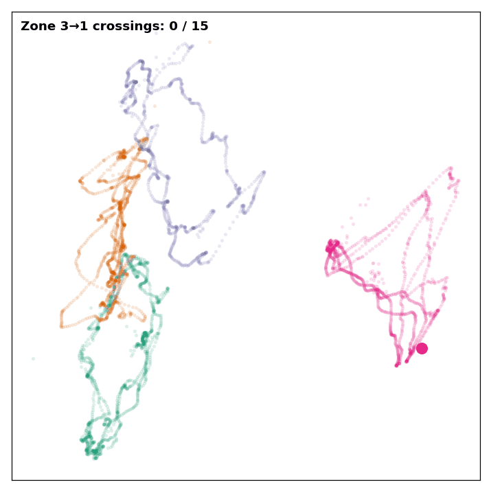
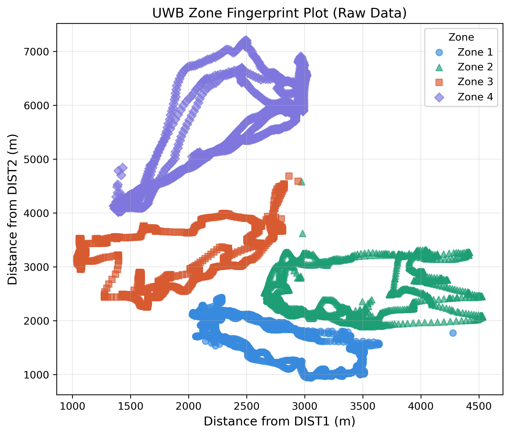
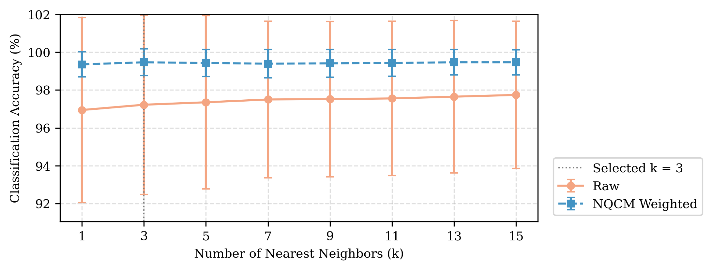
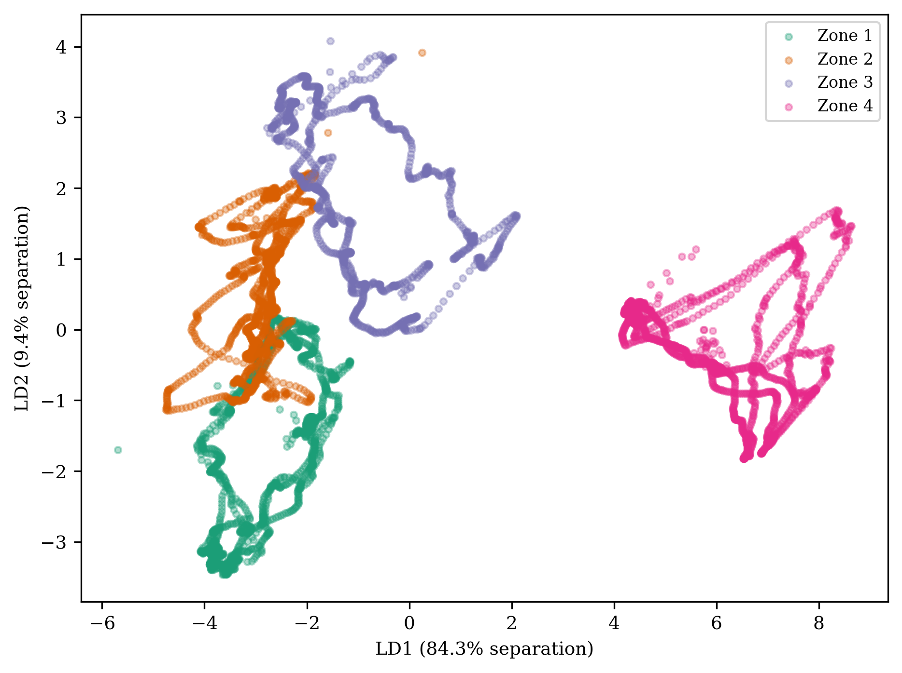
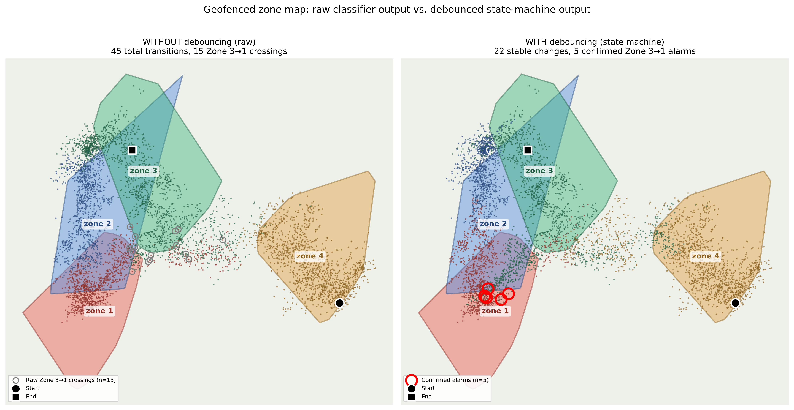

# UWB Indoor Zone Classification with a Modified Distance-Weighted KNN

Classifying which indoor zone a person is in from **Ultra-Wideband (UWB) ranging data**, using a
from-scratch Python implementation of a **Modified Distance-Weighted K-Nearest Neighbour (MDWKNN)**
classifier, an adaptive three-stage preprocessing pipeline, and a real-time **zone state machine**
for geofencing alarms.

This repository contains the code for my Master's thesis at OTH Regensburg:
*"Indoor Zone Classification using Measurement Data from Ultra-Wideband Sensors with K-Nearest Neighbours Classifier"*



*The tag carried through all four zones during an 80-second live walk. The counter shows the Zone 3 → Zone 1 crossings detected by the classifier. (File: `docs/images/zone31_counting_animation.gif`)*

---

## Highlights

- **99.46 % accuracy** (k = 3) separating four physically adjacent zones, under temporally ordered 5-fold cross-validation
- **Own dataset**: 5,400 fingerprint samples collected with four fixed UWB anchors and one mobile tag (hardware bought and set up by me)
- **Everything implemented from scratch** in NumPy: preprocessing outputs, anchor-reliability weights, weighted Manhattan distance, inverse-distance vote
- **Ablation study** isolating the contribution of each preprocessing stage
- **Stability**: preprocessing cut fold-to-fold accuracy variance from 18.66 to 0.49 (Levene's test, p = 0.0067)
- **Real-time layer**: a debouncing state machine reduced 45 raw zone changes to 22 stable ones, and 15 raw Zone 3 → Zone 1 crossings to 5 confirmed alarms

---

## The problem

Four zones in an indoor test area (three zones in one room, one in an adjoining corridor behind a door)
are separated by gaps of only 30–40 cm. A tag carried by a person measures its distance to four anchors
mounted at the room's corners. The task is to predict the zone from those four distances, reliably
enough to trigger an alarm when someone moves from one specific zone into another.

**Hardware:** five SynchronicIT SFM-10 modules (NXP Trimension OL23D0, IEEE 802.15.4z IR-UWB),
four as fixed anchors on 2 m tripods and one as the mobile tag. Distances were logged with Python.



---

## Method

```
raw distances ──► ZQCM ──► GQCM ──► NQCM ──► weighted Manhattan KNN ──► zone ──► state machine ──► alarm
                 (zeros)  (outliers) (smoothing)   (k = 3)                       (debounce + dwell)
```

| Stage | What it does |
|---|---|
| **ZQCM** – zero-value correction | Replaces dropped readings (distance = 0) by third-order Hermite interpolation |
| **GQCM** – gross-error correction | Flags outliers with a 3 × MAD rule over a 66-sample sliding window, then refills them |
| **NQCM** – noise correction | Smooths each anchor's signal with a moving Gaussian-weighted average |
| **Anchor weights** | Per zone and anchor, counts zero readings + flagged outliers in the training data and normalises them (Eq. 20 of Yang et al., 2024) |
| **Classifier** | Weighted Manhattan distance to every training sample → k nearest neighbours → inverse-distance weighted vote |
| **State machine** | Majority vote over a 1.5 s window, plus a 0.4 s dwell time before a new zone is accepted; fires a directional Zone 3 → Zone 1 alarm |

The approach replicates and extends **Yang et al. (2024), *Scientific Reports* 14:20846**. My contributions
are an independent implementation, my own UWB dataset, a dual evaluation protocol (shuffled and
temporally ordered cross-validation), a per-stage ablation study, and the state-machine layer.

---

## Results

**Classification (5-fold stratified CV, temporally ordered, k = 3):** 99.46 % accuracy with the full pipeline.

**Sensitivity to k (1–15):** the raw data scored 96.94–97.74 % with a fold standard deviation of 3.88–4.88 %;
the full pipeline scored 99.35–99.46 % with a standard deviation of only 0.66–0.75 %.



**Where the errors came from:** in the last fold, raw data confused Zone 1 with the adjacent Zone 2
(Zone 1 recall 0.58, 118 misclassified samples). Gross-error correction raised this to 0.85, smoothing
to 0.89, and the full weighted pipeline to 1.00, so the fix is tied to geometric adjacency, not luck.



**Real-time validation** on a separate 80-second walk (4,983 samples):

| | Raw classifier | With state machine |
|---|---|---|
| Zone changes | 45 | 22 |
| Zone 3 → Zone 1 events | 15 | **5 alarms** (at 9.1, 32.0, 53.7, 63.6, 73.1 s) |



### Honest notes

- The paired t-test between raw and fully preprocessed data was **not significant** (p ≈ 0.42) because
  accuracy is near the ceiling for both. The main benefit of preprocessing is **stability across folds**, not a large accuracy gain.
- The anchor weights follow Yang et al.'s Eq. 20 literally, which gives *more* weight to anchors with more
  errors. Overall accuracy changes little with the weighting (99.44 % uniform vs. 99.46 % weighted).
- Zones were recorded one after another, so temporal cross-validation is the main protocol; shuffled CV is reported only as a robustness check.

---

## Project structure

```
uwb-zone-classification/
├── config/
│   ├── settings.py           ← all file paths and k values (the only place to edit)
│   └── fold_indices.pkl      ← frozen CV folds, so every experiment uses identical splits
├── src/                      ← the core library
│   ├── data_loader.py        ← loads the fingerprint files for each preprocessing stage
│   ├── weights.py            ← anchor-reliability weight matrix
│   ├── knn_custom.py         ← weighted Manhattan distance, top-k, vote probabilities
│   ├── evaluator.py          ← accuracy, precision, recall, F1 (overall and per zone)
│   └── zone_state_machine.py ← debouncing + dwell-time + directional alarm
├── experiments/              ← one script per thesis experiment
│   ├── run_custom_knn_cv.py        ← main 5-fold CV over all k values
│   ├── run_ablation.py             ← contribution of each preprocessing stage
│   ├── run_sensitivity_analysis.py ← accuracy vs. k, raw vs. full pipeline
│   ├── run_variance_analysis.py    ← Levene's test on fold variance
│   ├── run_h1_paired_ttest.py      ← paired t-test, raw vs. full pipeline
│   ├── run_confusion_matrix.py     ← confusion matrices, shuffled and temporal CV
│   ├── run_fold5_zone_metrics.py   ← per-zone metrics for the hardest fold
│   ├── run_fold5_error_diagnostic.py ← which zone the errors went to
│   ├── run_baseline_comparison.py  ← scikit-learn KNN baselines
│   ├── run_best_k_report.py        ← classification report at the best k
│   ├── run_live_trajectory.py      ← predicts zones on the 80 s live walk
│   └── run_state_machine_demo.py   ← ★ runs without private data
├── figures/                  ← scripts that draw the thesis figures (output → figures/output/)
├── analysis/                 ← extra analyses: LDA/KDE separability, what NQCM does to the features
├── demos/zone3_trigger_demo.py ← animated live demo: a moving dot that triggers on entering Zone 3
├── notebooks/anchor_weight_checks.ipynb ← sanity checks on the weight matrix
├── results/                  ← saved predictions and result tables
├── docs/images/              ← images used in this README
└── data/                     ← put the dataset here (not included, see data/README.md)
```

---

## How to run

```bash
git clone https://github.com/<your-username>/uwb-zone-classification.git
cd uwb-zone-classification
pip install -r requirements.txt

# Works straight away: reproduces the state-machine result from saved predictions
python experiments/run_state_machine_demo.py
```

Expected output:

```
Zone changes      : raw  45  ->  stable  22
Zone 3 -> 1 events: raw  15  ->  alarms   5
Alarm times (s)   : [9.1, 32.0, 53.7, 63.6, 73.1]
```

The other experiments need the dataset in `data/` (see [data/README.md](data/README.md)). Then, from the project root:

```bash
python experiments/run_custom_knn_cv.py
python experiments/run_ablation.py
```

---

## Tools

Python · NumPy · pandas · scikit-learn · SciPy · Matplotlib

## Reference

Yang et al. (2024). *Scientific Reports*, 14, 20846. (Source of the MDWKNN framework and the ZQCM/GQCM/NQCM preprocessing scheme.)

## Author

**Sherin Abdul Latheef **, Master's in Microsystems and Electrical Engineering (Microsystems), OTH Regensburg
